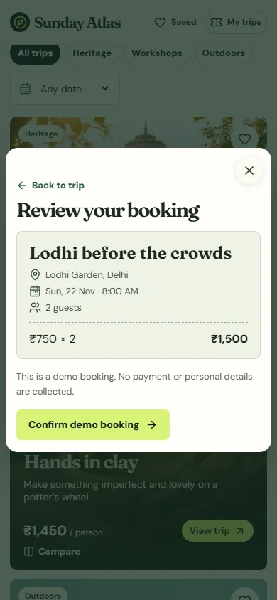

# Sunday Atlas

[Open the public catalog](https://aryan-stack-cloud.github.io/sunday-atlas/)

Sunday Atlas is a Delhi NCR experience site with a destination catalog, shareable trip pages, saved trips, comparison, and a database-backed reservation workflow. Each published departure has an operator-controlled date and available capacity.

## Design case study

The homepage uses one scroll sequence that pins the landscape, eases it into rotating trip cards, and then introduces the selected itinerary. Reverse scrolling retraces the sequence. The catalog and destination pages use the same twilight palette and scroll reveals. The homepage follows the motion sequence in the [Kamui reference](https://in.pinterest.com/pin/800303796276346241/) with an illustrated parallax scene, a purple 3D trip-card deck, and a darker itinerary panel illuminated by floating lights. The site includes a pause control and respects reduced-motion settings. The [destination reference](https://in.pinterest.com/pin/1032520652057780971/) informed the image-led trip pages, oversized place names, and postcard navigation. The artwork, brand, and layouts are original.


- **Discovery.** Browse by category, search for a place, filter departures by date, or compare trips by cost, duration, and seats.
- **Trip planning.** A dedicated page includes itinerary, start time, meeting point, and dates.
- **Reservations.** Visitors submit a request and track its status from the same browser. The operator confirms or declines requests and publishes or closes departures. Pending and confirmed parties count toward capacity.



## Run the full site

Requires Node 22.13 or later.

```sh
npm ci
npm run build
npm start
```

Open `http://127.0.0.1:4173` by default. Set `PORT` to choose another port. The app starts with an empty departure calendar. Set `ATLAS_ADMIN_KEY` to a randomly generated key of at least 32 characters in the ignored local `.env`. Use the Operator desk at `/#/operator` to publish dates you can actually host.

Bookings and departures are stored at `data/sunday-atlas.sqlite` by default. Set `ATLAS_DB` to use a persistent disk when hosting. Set `ATLAS_SAMPLE=1` with a separate database to exercise sample departures without collecting visitor details.

For a public booking deployment, run the Node server behind HTTPS, set `ATLAS_SECURE_COOKIE=1`, and publish approved provider dates. Store the operator key in the host's secret configuration and include an appropriate privacy notice for the operator's use of booking contact details. Customer access is tied to a browser session. Operators confirm and contact customers directly and arrange payment outside the application. On GitHub Pages the catalog, saved experiences, and browsing are available as static pages.

## Verify

```sh
npm run build
npm run test:server
npx playwright install chromium
npm test
```
