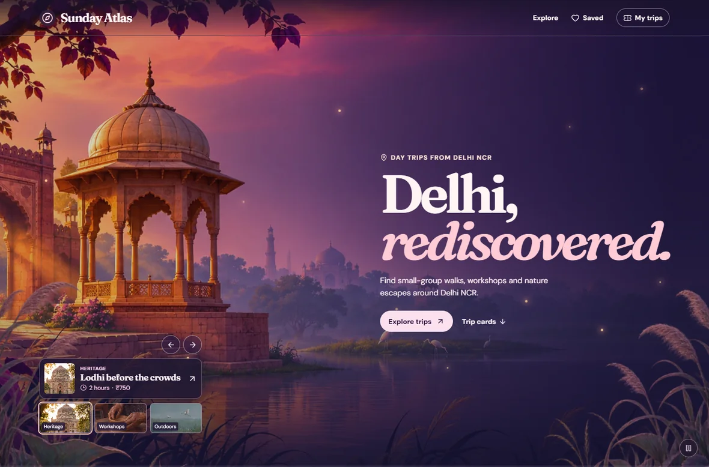

# Sunday Atlas

**[Try the booking demo](https://aryan-stack-cloud.github.io/sunday-atlas/)**

A responsive booking prototype for small-group experiences around Delhi NCR. Explore a heritage walk, a pottery workshop, or a birding trip, then choose a date and book in demo mode.



## UX case study

**Design question.** Can someone compare nearby weekend plans and see exactly what they’re booking in a few steps?

| Decision | How it appears in the product |
|---|---|
| Compare before opening a trip | Cards show the area, activity type and per-person price. Search and category filters narrow the list. |
| Make availability and cost visible early | Date choices show times and sold-out states. The price updates as guests change and appears again in the booking review. |
| Let people revisit a decision | Saved trips and demo bookings survive a reload. Bookings can be cancelled from My trips. |
| Support keyboard and mobile use | Dialogs trap focus, restore it on close, and respond to Escape. The layout supports 320px screens and reduced motion. |

The flows are design hypotheses implemented and tested in a browser. No user interviews or conversion results are claimed. Iteration could test whether users can find a trip for a set budget and explain the total before confirming.


## Run locally

```sh
npm ci
npm run dev
```

To verify the production build and run the booking tests:

```sh
npm run build
npx playwright install chromium
npm test
```

Built with React, TypeScript, and Vite. Trips and availability are sample data. Illustrative imagery was generated for the prototype. Bookings stay in browser storage and require no payment or contact details.
